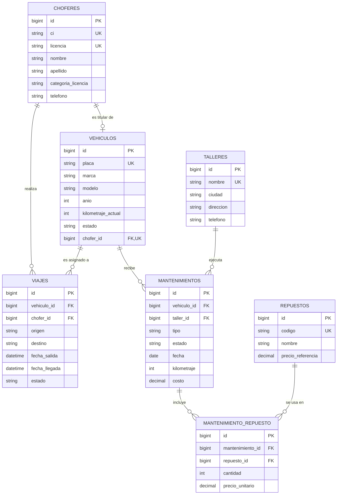

# Control de mantenimiento de una flota vehicular

Proyecto Laravel que valida el diseño de base de datos del **caso 7** del proyecto de grado:
migraciones, modelos Eloquent, factories, seeders y 10 consultas en Tinker que prueban la integridad del diseño.

## 1. Caso de estudio
Una empresa de transporte interprovincial controla el mantenimiento de sus buses. Cada vehículo tiene
placa, marca, modelo, año y kilometraje actual, y se asigna a un chofer titular. Los mantenimientos se
registran por tipo (preventivo o correctivo) con fecha, kilometraje, taller y costo, e incluyen varios
repuestos con cantidad y precio.

Reglas de negocio:
1. **Alerta:** un bus que supera 10.000 km desde su último mantenimiento preventivo.
2. **Bloqueo:** un bus en mantenimiento no puede asignarse a un viaje.
3. **Reporte:** costo total de mantenimiento por vehículo y por año.

## 2. Modelo entidad-relación


## 3. Migraciones (`database/migrations`)
| Tabla | Restricciones e índices |
|---|---|
| `choferes` | `ci` y `licencia` UNIQUE; `categoria_licencia` enum (default C); índice (apellido, nombre) |
| `talleres` | `nombre` UNIQUE |
| `repuestos` | `codigo` UNIQUE; índice en `nombre`; `precio_referencia` default 0 |
| `vehiculos` | `placa` UNIQUE; `chofer_id` nullable + UNIQUE + FK (`nullOnDelete`); `estado` enum (default disponible); índice en `estado` |
| `mantenimientos` | FK a `vehiculos` y `talleres` con `restrictOnDelete`; `tipo` enum; índices (vehiculo_id, tipo, kilometraje) y (vehiculo_id, fecha) |
| `mantenimiento_repuesto` | FK a `mantenimientos` (cascade) y `repuestos` (restrict); UNIQUE (mantenimiento_id, repuesto_id) |
| `viajes` | FK a `vehiculos` y `choferes` con `restrictOnDelete`; índice (vehiculo_id, fecha_salida) |

Decisiones de diseño:
- Un chofer es titular de **un solo** bus (`chofer_id` único) y un bus puede estar sin titular (nullable).
- No se puede borrar un vehículo ni un taller con historial de mantenimiento (`restrictOnDelete`).
- El precio del repuesto se guarda en la tabla pivote (`precio_unitario`) para conservar el precio histórico.
- El índice (vehiculo_id, tipo, kilometraje) acelera la alerta de 10.000 km.

## 4. Modelos y relaciones (`app/Models`)
| Relación | Tipo | Implementación |
|---|---|---|
| Chofer – Vehículo (titular) | 1:1 | `Chofer hasOne Vehiculo` / `Vehiculo belongsTo Chofer` |
| Vehículo – Mantenimientos | 1:N | `hasMany` / `belongsTo` |
| Taller – Mantenimientos | 1:N | `hasMany` / `belongsTo` |
| Mantenimiento – Repuestos | N:M | `belongsToMany` con `withPivot('cantidad','precio_unitario')` |
| Vehículo y Chofer – Viajes | 1:N | `hasMany` / `belongsTo` |

Reglas de negocio en el código:
- `Vehiculo::necesitanMantenimiento()` (scope SQL) y `Vehiculo::kmDesdeUltimoPreventivo()`; `php artisan flota:alertas` lista los buses con alerta.
- `Viaje` (evento `saving`): lanza `DomainException` si el bus está en mantenimiento o dado de baja.
- `Mantenimiento` (evento `saved`): actualiza el kilometraje del bus y sincroniza su estado (`en_mantenimiento` / `disponible`).
- `Mantenimiento::reporteCostoPorVehiculoAnio()`: costo total (mano de obra + repuestos) por placa y año.

## 5. Factories y seeders
Hay una factory por modelo con datos del dominio (apellidos bolivianos, buses Volvo/Scania/Mercedes-Benz/Hyundai/Yutong
con modelos coherentes por marca, placas `0000-ABC`, repuestos reales de buses, rutas entre ciudades de Bolivia).

`FlotaSeeder` genera: 12 choferes, 5 talleres, 25 repuestos, 10 buses con 5 a 7 mantenimientos finalizados cada uno
(con 1 a 4 repuestos), viajes finalizados y programados, y un correctivo en proceso (un bus queda `en_mantenimiento`).
Los 3 primeros buses quedan por encima de 10.000 km para que la alerta tenga resultados.

## 6. Consultas en Tinker
Las 10 consultas, listas para copiar y pegar, están en [`GUIA_TINKER.md`](GUIA_TINKER.md).

| # | Categoría | Qué valida |
|---|---|---|
| 1 | Relaciones | FKs y pivote resueltos en ambos sentidos |
| 2 | Integridad | UNIQUE en `vehiculos.placa` |
| 3 | Integridad | FK inexistente y `restrictOnDelete` |
| 4 | Integridad | Bus en mantenimiento no puede viajar |
| 5 | Regla de negocio + Collection | Alerta de 10.000 km |
| 6 | Collection | `groupBy` por tipo con costo total |
| 7 | Collection | `filter` + `sortByDesc` de correctivos costosos |
| 8 | Agregación | `SUM`/`COUNT` por vehículo y año |
| 9 | Agregación | `HAVING`: buses con 2+ correctivos |
| 10 | Agregación | `avg`/`count`/`sum` por taller |

## 7. Cómo ejecutarlo
Ver [`INSTALACION.md`](INSTALACION.md). Resumen:
```powershell
php artisan migrate:fresh --seed
php artisan flota:alertas
php artisan tinker
```
Base de datos: SQLite por defecto (`database/database.sqlite`); MySQL opcional (`.env.mysql.example`).

## 8. Estructura
```
app/Models/                 Chofer, Taller, Repuesto, Vehiculo, Mantenimiento, Viaje
app/Console/Commands/       AlertasMantenimiento (flota:alertas)
database/migrations/        7 migraciones
database/factories/         6 factories
database/seeders/           DatabaseSeeder, FlotaSeeder
database/sql/               crear_base_datos.sql (solo MySQL)
scripts/                    instalar.ps1, commits.ps1
GUIA_TINKER.md              10 consultas y pasos para las capturas
```
